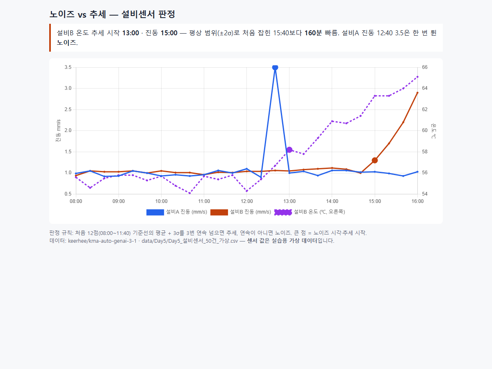

# 예지보전 실습판: 노이즈 vs 추세 — learn-pdm-lite-hgd

설비센서 가상 데이터로 한 번 튄 값(노이즈)과 꾸준한 상승(추세)을 구분하고, 그래프 한 장짜리 대시보드를 공개하는 10분 실습. 수업은 Claude Code 스킬 `/learn-pdm-lite-hgd`가 진행한다 (Skills as Curriculum). 이 강의는 hgd가 course-forge로 직접 만들었다.

- **결과 대시보드**: https://keerhee.github.io/learn-pdm-lite-hgd/
- 처음이면 [GUIDE.md](GUIDE.md)부터. 기본 환경은 Claude 데스크톱 앱(Code 탭). VS Code는 GUIDE 부록 B



## 설치 — 한 줄

Claude Code 입력칸에 붙여 넣는다.

```
npx skills add keerhee/learn-pdm-lite-hgd --agent claude-code --global --yes 를 실행해 줘
```

새 세션에서 `/learn-pdm-lite-hgd`를 입력하면 수업이 시작된다. zip을 받았다면 압축을 풀어 `.claude/skills/learn-pdm-lite-hgd` 폴더를 내 홈의 `.claude/skills/`로 복사한다.

## 블록

| Block | 주제 | 끝나면 생기는 것 |
|---|---|---|
| 0 | 준비 (2분) | `~/pdm-lite` 폴더, 센서 csv, `env_check.txt` |
| 1 | 노이즈 vs 추세 (5분) | 판정표 `trend_judgement.csv`, 그래프 한 장 `index.html` · 퀴즈 1문항 |
| 2 | 공개 (3분) | 휴대폰에서도 열리는 대시보드 주소 |

## 수업 방식

| 구분 | 내용 |
|---|---|
| 목표 — AI Native | AI에게 맡기는 것이 기본인 방식으로 일한다 |
| 방법 — Skills as Curriculum | 스킬이 블록마다 설명 → 실습 → STOP → 확인·퀴즈를 진행한다 |
| 형식 — 자율학습 | 강사 없이 자기 속도로, 퀴즈로 스스로 점검한다 |

## 원본 강의와 데이터 출처

| 자료 | 출처 | 구분 |
|---|---|---|
| 본 강의 덱 | `keerhee/kma-auto-genai-3-1` · `Day5_예지보전/Day5_3_Main_자동차예지보전AI활용.pdf` | 강의 자료 |
| 판정 규칙 (기준선 평균 + 3σ, 3번 연속) | 같은 저장소 · `보충교재/Day5_예지보전/06_예지보전_따라하기_II/PdM_Prompts_II.md` 프롬프트 3 | 강의 자료 |
| 센서 데이터 | 같은 저장소 · `data/Day5/Day5_설비센서_50건_가상.csv` → `assets/lab/sensor_50_virtual.csv` | **실습용 가상 데이터** |

## 개정 이력

| 날짜 | 바뀐 점 |
|---|---|
| 2026-10-31 | 첫 판 — 블록 3개(준비 / 노이즈 vs 추세 / 공개), 퀴즈 1문항 |

## 만든 방법

- `/course-forge`로 만들었다. 제작 기록(원본 요약·커리큘럼·검수 결과)은 `forge/`에 있다.
- 출처: 원본 강의 저장소 https://github.com/keerhee/kma-auto-genai-3-1
